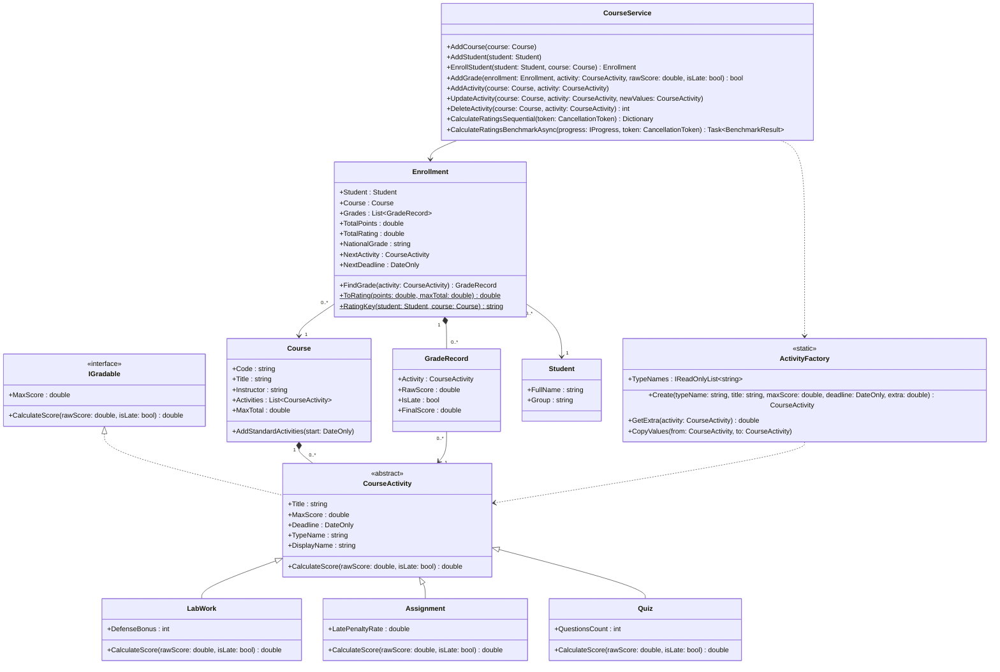
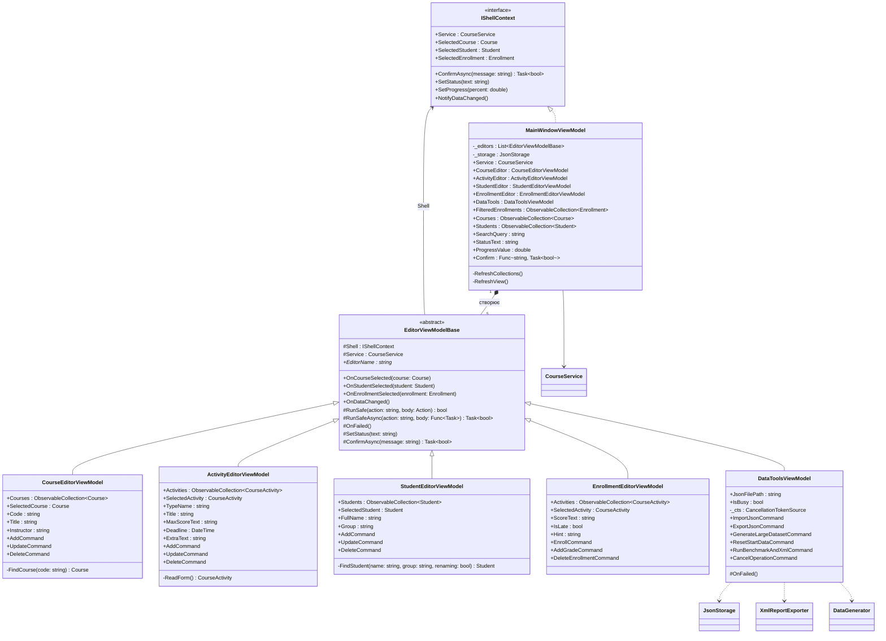

# Специфікація проєкту «Система управління навчальними курсами»

## 1. Архітектура MVVM
- `Models/` – інтерфейс `IGradable`, абстрактний клас `CourseActivity`, спадкоємці `LabWork`, `Assignment`, `Quiz` з поліморфним методом `CalculateScore()`, статичний клас `ActivityFactory` (створення роботи потрібного типу для CRUD робіт), класи `Course`, `Student`, `GradeRecord`, `Enrollment`, `StorageData`, `BenchmarkResult`.
- `Services/` – `CourseService` (CRUD курсів, здобувачів і робіт курсу, валідація, перевірка повторного запису, розрахунок рейтингу `T1`/`Tn` із `lock` та `CancellationToken`), `DataGenerator`.
- `Repositories/` – `JsonStorage` (атомарне збереження та прив'язка посилань `ValidateAndLink()`), `XmlReportExporter`.
- `ViewModels/` – головна ViewModel і окрема дочірня ViewModel для кожного блоку вікна:
  - `MainWindowViewModel` (оболонка) – лише спільне: `CourseService`, списки курсів і здобувачів, таблиця записів із пошуком, фільтрами й сортуванням, обрані курс / здобувач / запис, рядок стану, прогрес, підтвердження. Створює дочірні редактори й передає їм себе як `IShellContext` та потрібні дані (списки, `JsonStorage`);
  - `IShellContext` – інтерфейс спільного стану: `Service`, `SelectedCourse`, `SelectedStudent`, `SelectedEnrollment`, `ConfirmAsync()`, `SetStatus()`, `SetProgress()`, `NotifyDataChanged()`. Дочірні ViewModel працюють тільки через нього і не звертаються до `MainWindowViewModel` напряму;
  - `EditorViewModelBase` – абстрактний базовий клас редакторів: абстрактна властивість `EditorName`, віртуальні реакції на зміну вибору й даних (`OnCourseSelected()`, `OnStudentSelected()`, `OnEnrollmentSelected()`, `OnDataChanged()`, `OnFailed()`), єдина обробка помилок `RunSafe()` / `RunSafeAsync()` (журнал Serilog + рядок стану) замість `try/catch` у кожній команді;
  - `CourseEditorViewModel` – «Керування курсами»; `ActivityEditorViewModel` – «Роботи курсу» (CRUD робіт); `StudentEditorViewModel` – «Керування здобувачами»; `EnrollmentEditorViewModel` – «Запис на курс і оцінки»; `DataToolsViewModel` – імпорт/експорт JSON, генерація наборів, T1/Tn і XML.
  - Головна ViewModel тримає редактори у списку `List<EditorViewModelBase>` і при зміні вибору чи даних викликає для кожного віртуальний метод – поліморфізм на рівні ViewModel.
- `Views/` – `MainWindow.axaml` (інтерфейс із `DataGrid`, формами CRUD та `ProgressBar`; кожен блок має свій `DataContext="{Binding CourseEditor}"` тощо і `x:DataType` для скомпільованих прив'язок), `ConfirmDialog` (вікно підтвердження «Так / Скасувати», передається в головну ViewModel через властивість `Confirm`).

## 2. UML-діаграми класів

### 2.1. Модель і сервіси (Mermaid)

### 2.2. Шар ViewModel (Mermaid)

Головна ViewModel створює редактори (композиція) і передає їм себе лише як `IShellContext`, тому стрілка від редакторів веде до інтерфейсу, а не до `MainWindowViewModel`. Перевизначення в похідних класах: усі реалізують `EditorName`; `CourseEditorViewModel` – `OnCourseSelected()`, `StudentEditorViewModel` – `OnStudentSelected()`, `ActivityEditorViewModel` – `OnCourseSelected()` і `OnDataChanged()`, `EnrollmentEditorViewModel` – `OnEnrollmentSelected()` і `OnDataChanged()`, `DataToolsViewModel` – `OnFailed()`.

## 3. Ключові алгоритми (для блок-схем за ДСТУ ISO 5807:2016)
1. **Розрахунок рейтингу частинами (`CalculateRatingsBenchmarkAsync`)**: зняття знімка записів разом із копіями масивів оцінок під `lock` (зміни в інтерфейсі під час розрахунку не зачіпають знімок) → прогрів обох варіантів без заміру (JIT і пул потоків) → три однопотокові заміри, у `T1` береться найкращий → розбиття знімка на частини за кількістю ядер → паралельний запуск `Task.Run` із перевіркою `CancellationToken`, три заміри, у `Tn` найкращий → об'єднання локальних словників під `lock` → оновлення `IProgress<double>` після кожного кроку → обчислення прискорення `S = T1 / Tn`. Для чесних замірів методи розрахунку позначено `[MethodImpl(MethodImplOptions.AggressiveOptimization)]`: вони одразу компілюються оптимізовано, а решта програми стартує швидко.
2. **Перевірка запису на курс (`EnrollStudent`)**: перевірка аргументів на `null` → вхід у критичну секцію `lock` → перевірка, що здобувач і курс є у списках → пошук у `_enrollments` запису цього здобувача (ПІБ + група, без урахування регістру) саме на цей курс → якщо такий запис є, `InvalidOperationException` «Повторний запис заборонено» → інакше створення `Enrollment` і додавання до списку (на інших курсах здобувач може навчатися одночасно).
3. **Виконання команди редактора (`EditorViewModelBase.RunSafe`)**: команда перевіряє введення (порожні поля, числа) і за потреби питає підтвердження через `IShellContext.ConfirmAsync()` → `RunSafe()` виконує дію в блоці `try` → дія змінює дані через `CourseService` і викликає `NotifyDataChanged()` (збереження `courses.json`, оновлення списків і таблиці, виклик `OnDataChanged()` у кожного редактора) → успіх: повідомлення в рядку стану → помилка (`catch`): запис у `app.log` (попередження для `ArgumentException` / `InvalidOperationException`, інакше помилка), текст помилки в рядку стану, виклик віртуального `OnFailed()`.
4. **Зміна роботи курсу (`CourseService.UpdateActivity`)**: форма зчитується в тимчасовий об'єкт через `ActivityFactory.Create()` (сеттери перевіряють назву, максимум 0–100, дату, параметр типу) → вхід у `lock` → перевірка, що робота належить курсу і нова назва не зайнята іншою роботою → пошук найбільшого вже виставленого балу за цю роботу → якщо новий максимум менший, `InvalidOperationException` → інакше `ActivityFactory.CopyValues()` переносить значення в наявний об'єкт (оцінки лишаються прив'язаними до нього).

## 4. Правила предметної області
- Новий курс отримує стандартний набір на 100 балів: 4 лабораторні по 15 балів, 2 практичні по 10, 2 тести по 10 (`Course.AddStandardActivities()`). Далі роботи можна додавати, змінювати й видаляти в блоці «Роботи курсу»: тип (лабораторна, практична, тест), назва (унікальна в курсі), максимальний бал (більше 0, до 100), дедлайн і параметр типу (бонус за захист 0–10, штраф за запізнення 0–50 %, кількість питань 1–200). Тип наявної роботи не змінюється, максимум не може стати меншим за вже виставлену оцінку, видалення роботи видаляє й оцінки за неї (після підтвердження).
- Рейтинг (`Enrollment.TotalRating`) – набрані бали у відсотках від суми максимумів робіт курсу (`Course.MaxTotal`), тож шкала завжди 0–100 незалежно від кількості робіт; для стандартного курсу рейтинг дорівнює сумі балів.
- За кожну роботу в записі зберігається одна оцінка; повторне виставлення замінює попередню (`CourseService.AddGrade()`), тому рейтинг не перевищує 100.
- Переведення в національну шкалу (`Enrollment.NationalGrade`): 90–100 «відмінно», 74–89 «добре», 60–73 «задовільно», менше 60 «незадовільно».
- Здобувач може навчатися на кількох курсах (у таблиці – окремий рядок для кожного запису); заборонено лише повторний запис на той самий курс (`CourseService.EnrollStudent()`, перевірка при імпорті в `JsonStorage.ValidateAndLink()`). Багатопотоковий розрахунок і XML використовують ключ «ПІБ (група) | курс» (`Enrollment.RatingKey()`).
- Наступна робота (`Enrollment.NextActivity`) – робота курсу з найранішим дедлайном, за яку ще немає оцінки. Таблиця показує її назву і дедлайн (з позначкою «простр.», якщо дата минула), сортування «Наступний дедлайн» ставить угору найстаріші борги, фільтр відбирає записи за типом наступної роботи або «Усе здано».
- Підрахунок балів: лабораторна – бал + бонус за захист (лише якщо бал більший за 0), при запізненні 85 % без бонусу; практична – мінус `LatePenaltyRate` при запізненні; тест – бал округлюється вниз до цілої кількості правильних відповідей (`MaxScore / QuestionsCount` за питання), при запізненні 70 %. Підсумок роботи не перевищує її максимум.
- Видалення курсу, роботи курсу, здобувача, запису, імпорт JSON і генерація великого набору виконуються лише після підтвердження в `ConfirmDialog`.
- «Експорт JSON» зберігає дані у файл, вказаний у полі шляху (те саме поле використовує імпорт). Після успішного імпорту чи генерації дані одразу зберігаються в `courses.json`; при помилці імпорту поточні дані не змінюються.
- Під час імпорту `JsonStorage.ValidateAndLink()` відхиляє файли з повторними кодами курсів, повторними здобувачами, двома роботами з однією назвою в курсі, повторним записом на той самий курс, двома оцінками за ту саму роботу та балами поза межами.
- Оновлення курсу чи здобувача спершу перевіряє всі нові значення, тому при помилці запис не змінюється частково. Код курсу не змінюється.
- Якщо в полях введено ПІБ чи код, «Оновити» / «Видалити» виконуються саме для введеного здобувача / курсу, а не для вибраного у списку. «Записати» записує здобувача, обраного в «Керуванні здобувачами», на курс, обраний у «Керуванні курсами».
- Клік по рядку таблиці обирає його здобувача і курс у правій панелі (поля заповнюються), тож одразу можна натиснути «Оновити». `Student`, `Course` і `CourseActivity` реалізують `INotifyPropertyChanged`, тому нові ПІБ, група, назва курсу чи роботи одразу видно в таблиці та випадних списках.
- Фільтр груп будується з наявних даних (нова група одразу з'являється у списку). Таблиця показує до 500 рядків, лічильник унизу повідомляє «Показано 500 з N».
- XML-відомість (`course_grade_sheet.xml`) згрупована за курсами; у кожному курсі записи здобувачів відсортовані за спаданням рейтингу, для кожного вказано групу, рейтинг і оцінку за національною шкалою.
- Стартовий набір: 100 здобувачів (по 25 у групах 3РП-11, 2РП-12, 3КІ-21, 2КІ-22), близько третини з них навчаються на двох курсах (129 записів), частина робіт слабших здобувачів ще не оцінена. Великий набір для замірів T1/Tn: рівно 15 000 оцінок; частина здобувачів має борги, тому записів близько 2080 (≈1600 здобувачів) (`DataGenerator.Generate()` додає їх, доки не набереться потрібна кількість оцінок). Кнопка «Стартовий набір» (`DataGenerator.GenerateStartSet()`) повертає 100 здобувачів.
